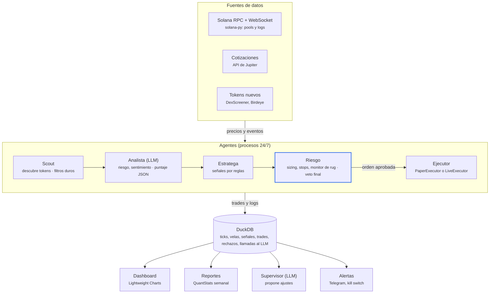
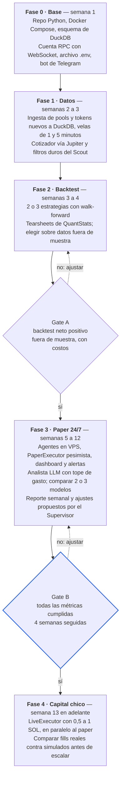

# Agentes de trading 24/7 en Solana — Análisis y plan

Actualizado: 2026-11-24 · Versión editable online: https://claude.ai/artifact/8Y5LCiMPYDusRyjpyVaw9X

## Índice

1. [Resumen ejecutivo](#resumen-ejecutivo)
2. [Referencia: el post de DN_degen](#referencia-el-post-de-dn_degen)
3. [Análisis del stack](#análisis-del-stack)
4. [Auditoría de seguridad de los repos](#auditoría-de-seguridad-de-los-repos)
5. [Elección de LLM](#elección-de-llm)
6. [Arquitectura de agentes](#arquitectura-de-agentes)
7. [Paper trading: el simulador](#paper-trading-el-simulador)
8. [Gestión de riesgo y kill switches](#gestión-de-riesgo-y-kill-switches)
9. [Métricas y criterio para pasar a dinero real](#métricas-y-criterio-para-pasar-a-dinero-real)
10. [Plan por fases](#plan-por-fases)
11. [Infra 24/7, costos y riesgos](#infra-247-costos-y-riesgos)
12. [Decisiones tomadas](#decisiones-tomadas)

---

## Resumen ejecutivo

Construimos un sistema de agentes que opera tokens de Solana 24/7. Primero funciona **100% en paper trading**, con dinero simulado y precios reales. Recién después, y solo si los números lo justifican, pasa a operar con poco capital real.

- **La IA no decide sola cada trade.** Las señales, el sizing y el riesgo son código determinista y backtesteable. El LLM se usa donde aporta: filtrar tokens, leer contexto, explicar y auditar decisiones. Eso baja el costo y hace que los resultados se puedan reproducir.
- **Stack en Python:** solana-py/solders para leer la cadena, API de Jupiter para cotizar sobre Raydium y Orca, DuckDB como base analítica, vectorbt (opcional) para backtesting, QuantStats para reportes y Lightweight Charts para el dashboard.
- **LLM barato y reemplazable:** todos los modelos van detrás de una sola interfaz, para comparar Grok, Gemini Flash, DeepSeek o Claude Haiku por costo y calidad con datos propios.
- **Criterio de éxito:** 4 a 8 semanas de paper trading con métricas que superen umbrales fijados antes de empezar. Sin eso, no hay dinero real.

---

## Referencia: el post de DN_degen

El [post](https://x.com/DN_degen/status/2124229931525951561) es marketing, no una arquitectura. Afirma convertir USD 362 en USD 44.918 (123,8x) en una noche con 8 agentes de Grok. Una nota de la comunidad advierte que la cuenta publicó versiones casi idénticas con montos, tokens y protagonistas distintos.

Señales de que no es un sistema real:

- **Los repos no corresponden a los roles.** RISK enlaza a vectorbt (backtesting), RUG a DuckDB (una base de datos), EXIT a Lightweight Charts (gráficos) y DESK MANAGER a QuantStats (reportes). Ninguno hace lo que dice el rol.
- **Mezcla dos negocios distintos:** arbitraje de BTC entre Binance, Bybit y Coinbase, y sniping de memecoins en Solana. El arbitraje entre exchanges centralizados lo dominan firmas con servidores en el mismo datacenter que el exchange. Un bot casero con LLM no compite ahí.
- **"Pégalo en Grok" no construye nada.** Un chat no corre procesos 24/7, no firma transacciones ni guarda estado.
- **El riesgo es incoherente:** arriesga hasta 40% del capital por operación con un stop de -6% en memecoins, donde una vela de -50% salta cualquier stop.
- **Cierra con un link a gmgn.ai**, probablemente con referido: el post vende la plataforma.

Lo que sí vale la pena tomar, y cómo encaja en nuestro diseño:

| Rol del post | Idea útil | Dónde va en nuestro sistema |
| --- | --- | --- |
| SCANNER | Detectar pares nuevos y picos de volumen | Scout |
| RISK y RUG | Revisar mint/freeze authority, liquidez bloqueada y holders; vigilar la wallet del dev mientras hay posición | Filtros duros del Scout + monitor de rug dentro de Riesgo |
| SNIPER | Ejecutar apenas pasan los chequeos | Ejecutor (sin competir por milisegundos) |
| WHALE | Seguir wallets rentables | Agente opcional en fase 3, como señal extra |
| HYPE | Puntaje de impulso social | Analista LLM (acá Grok sí suma, por X) |
| EXIT | Trailing stop y venta por tramos | Riesgo |
| DESK MANAGER | No opera, avisa lo importante | Supervisor + alertas |

También tomamos tres reglas buenas:

- Slippage máximo de 2%.
- Cada trade se registra con su motivo antes de ejecutarse.
- Cada oportunidad rechazada queda logueada con su razón, por ejemplo: `RECHAZADA: slippage estimado 3,4%, límite 2,0%`.

---

## Análisis del stack

Usamos como librería lo que es infraestructura difícil y escribimos nosotros la lógica de negocio: agentes, filtros, simulador y riesgo.

| Repo | Lenguaje | Rol en el sistema | ¿Lo usamos? | Fase |
| --- | --- | --- | --- | --- |
| [solana-py](https://github.com/michaelhly/solana-py) | Python | RPC/WebSocket: balances, cuentas de pools, logs; más adelante enviar transacciones (con `solders`) | Sí, como librería | 1 |
| [DuckDB](https://github.com/duckdb/duckdb) | C++ con API Python | Base analítica local: ticks, velas, señales, trades simulados y logs del LLM. Archivo único, SQL rápido, lee y escribe Parquet | Sí, como librería | 1 |
| [QuantStats](https://github.com/ranaroussi/quantstats) | Python | Reportes de rendimiento: Sharpe, Sortino, drawdown, win rate, tearsheet HTML | Sí, como librería | 2 |
| [Lightweight Charts](https://github.com/tradingview/lightweight-charts) | JavaScript | Dashboard: velas, marcas de entrada/salida, curva de equity | Sí, como librería | 3 |
| [vectorbt](https://github.com/polakowo/vectorbt) | Python | Backtesting vectorizado y barrido de parámetros | Opcional | 2 |
| [raydium-sdk-V2](https://github.com/raydium-io/raydium-sdk-V2) | TypeScript | Estado de pools AMM/CLMM de Raydium, cotización y armado de swaps | No al principio (Jupiter lo cubre) | 4 si hace falta |
| [orca whirlpools](https://github.com/orca-so/whirlpools) | TypeScript / Rust | Lo mismo para pools concentrados de Orca | No al principio (Jupiter lo cubre) | 4 si hace falta |

Decisiones derivadas:

- **Jupiter en lugar de los SDKs de Raydium y Orca.** La API de Jupiter cotiza y arma swaps ruteando entre Raydium, Orca y otros DEX. Así no hace falta un sidecar en Node y evitamos la duda de licencias. A cambio dependemos de un servicio externo. Los SDKs directos quedan solo para el caso de necesitar menos latencia o más control.
- **vectorbt es opcional.** Para estrategias simples sobre velas alcanza un backtester propio de unas 300 líneas con pandas, que reusa el mismo código de estrategia que corre en vivo. vectorbt sirve si queremos barrer miles de combinaciones de parámetros.
- **Datos de mercado:** el RPC público de Solana no aguanta 24/7 con muchos pools. Hace falta un proveedor RPC con WebSocket (Helius, QuickNode, Triton u otro), con plan gratis para empezar.
- **Descubrimiento de tokens:** ninguno de los repos lo resuelve. Sumamos una fuente de tokens nuevos y métricas: DexScreener, Birdeye, o escuchar la creación de pools vía logs.

---

## Auditoría de seguridad de los repos

Revisé los 7 repos el 24/11/2026 y no encontré malware ni señales de compromiso. Todos son los originales, están activos y los mantienen sus autores o empresas conocidas. El riesgo real no está en estos repos sino en copias falsas con nombres parecidos.

| Repo | Estrellas | Dueño | Paquete oficial | Licencia | Resultado |
| --- | --- | --- | --- | --- | --- |
| [duckdb](https://github.com/duckdb/duckdb) | 43.280 | DuckDB Labs (org) | `duckdb` (PyPI) | MIT | Sin hallazgos |
| [lightweight-charts](https://github.com/tradingview/lightweight-charts) | 17.961 | TradingView (org) | `lightweight-charts` (npm) | Apache-2.0 | Sin hallazgos |
| [vectorbt](https://github.com/polakowo/vectorbt) | 9.925 | polakowo, autor original | `vectorbt` (PyPI) | Apache-2.0 + Commons Clause | Sin hallazgos; no se puede vender el software |
| [quantstats](https://github.com/ranaroussi/quantstats) | 7.909 | ranaroussi, autor original | `quantstats` (PyPI) | Apache-2.0 | Sin hallazgos |
| [solana-py](https://github.com/michaelhly/solana-py) | 1.448 | michaelhly, autor original | `solana` + `solders` (PyPI) | MIT | Sin hallazgos |
| [whirlpools](https://github.com/orca-so/whirlpools) | 569 | Orca (org) | `@orca-so/whirlpools` (npm) | Orca License desde feb 2025 | Sin hallazgos; licencia propietaria |
| [raydium-sdk-V2](https://github.com/raydium-io/raydium-sdk-V2) | 354 | Raydium (org) | `@raydium-io/raydium-sdk-v2` (npm) | GPL-3.0 | Sin hallazgos; el paquete está en versión alpha |

Qué revisé:

- Que ninguno sea un fork, y los últimos 15 commits de cada uno.
- Scripts que corren al instalar: solo `husky install` en Raydium, que es inofensivo.
- Código ofuscado o `eval` de base64. La única línea larga sospechosa, en Raydium, resultó ser datos de una lookup table comentados.
- Envío de claves privadas a servidores externos.
- URLs escritas en el código: solo dominios propios (raydium.io, solana.com, jup.ag, vectorbt.pro).
- Que el paquete de PyPI o npm apunte al repo oficial.

DuckDB y Lightweight Charts no los cloné enteros por su tamaño. Son de empresas grandes y los usamos como paquete publicado.

Reglas para no meter malware después:

- Instalar solo los nombres exactos de la tabla, con versiones fijadas y lockfile (`uv.lock`, `package-lock.json`). Las estafas típicas son paquetes con nombres parecidos, como `solana-py-sdk` o `raydium-sdk-v3`.
- Nunca copiar repos de links acortados ni "bots de trading gratis" de X o Telegram: es el vector número uno de robo de wallets.
- Revisar el diff antes de actualizar dependencias; nada de `npm install` con `latest`.
- La clave privada nunca está en la máquina de desarrollo ni en el repo. En la fase 4 vive solo en el VPS.

---

## Elección de LLM

Recomendación: no casarse con Grok. Arrancar con un modelo chico y barato detrás de una interfaz propia (`LLMClient`). Tras 2 semanas de paper trading, elegir con datos, comparando modelos sobre las mismas decisiones.

**Dónde SÍ usar IA** (pocas llamadas, alto valor):

- **Filtro de candidatos:** dado un token nuevo con sus métricas (liquidez, holders, edad, distribución, redes sociales), clasificar el riesgo de rug o estafa y dar un puntaje con justificación en JSON.
- **Contexto y sentimiento:** resumir menciones y noticias del token. Acá Grok tiene ventaja real por su acceso a datos de X.
- **Supervisor:** revisar cada trade cerrado y cada día, detectar patrones de pérdida y proponer ajustes de parámetros, que aprueba una persona.

**Dónde NO usar IA:** cálculo de señales, sizing, stop loss, take profit y ejecución. Son reglas deterministas: más rápidas, gratis y backtesteables. Un LLM ahí no se puede backtestear de forma honesta y agrega latencia.

| Opción | Fuerte en | Débil en | Uso sugerido |
| --- | --- | --- | --- |
| Grok (modelos mini/fast) | Acceso a contenido de X, sentimiento | Atado a un proveedor | Agente de sentimiento |
| Gemini Flash | Muy barato, rápido, contexto largo | Razonamiento fino | Filtro de candidatos a volumen |
| DeepSeek | Muy barato, buen razonamiento | Disponibilidad y latencia variables | Filtro o supervisor |
| Claude Haiku 5.5 | JSON estructurado confiable, tool use | Algo más caro que los anteriores | Supervisor y explicaciones |
| Modelo local (Ollama) | Costo cero por llamada | Calidad menor, requiere GPU | Pre-filtro que descarta lo obvio |

Control de costo:

- Llamar al LLM solo con candidatos que ya pasaron los filtros duros (liquidez mínima, mint/freeze authority revocadas, top holders), no en cada tick.
- Cachear por token y reusar prompts fijos (prompt caching donde exista).
- Poner un tope de gasto diario en el código: si se supera, el sistema sigue con reglas sin IA.
- Loguear en DuckDB cada llamada (modelo, tokens, costo, respuesta) para medir el costo por trade.

Los precios de los modelos cambian seguido: hay que verificarlos al elegir y cargarlos en la configuración, no en el código.

---

## Arquitectura de agentes

Cada orden pasa por el agente de riesgo antes de ejecutarse.

El LLM se usa solo en el Analista y el Supervisor; el resto es código determinista y backtesteable.

Scout y Analista eligen candidatos, el Estratega emite la señal, Riesgo puede vetarla y el Ejecutor la llena contra una cotización real. El Supervisor lee DuckDB y propone ajustes de parámetros que aprueba una persona; nunca cambia la configuración por su cuenta.

---

## Paper trading: el simulador

El simulador es la pieza que más importa: si es optimista, todo resultado es falso. Cada orden simulada se llena contra una **cotización real del momento**, no contra el último precio, y paga todos los costos que pagaría en vivo.

Cómo se llena una orden simulada:

1. El Ejecutor pide a Jupiter una cotización real para el monto exacto. Esa cotización ya incluye el price impact según la liquidez del pool.
2. Se aplica una demora de 1 a 3 segundos, lo que tarda una transacción real en confirmar, y se vuelve a cotizar. Se usa el peor de los dos precios.
3. Se descuentan el fee del pool, el fee de red, la priority fee y un slippage extra configurable.
4. En tokens muy volátiles se simula una tasa de fallo de transacciones, por ejemplo de 5 a 10%.
5. Si el token no tiene liquidez suficiente para salir, la posición queda atrapada: el simulador no puede vender a un precio que no existe.

Cuenta virtual:

- Saldo inicial en SOL o USDC (por ejemplo 10 SOL), con historial completo en DuckDB.
- El código de estrategia es el mismo en paper y en vivo; solo cambia el `Executor` (`PaperExecutor` o `LiveExecutor`). Así, lo que se probó es exactamente lo que corre.
- Se guardan el precio cotizado, el precio llenado y la diferencia, para calibrar el slippage simulado contra el real en la fase de capital chico.

---

## Gestión de riesgo y kill switches

El agente de riesgo tiene veto sobre todo y es código puro, sin LLM. Los valores de abajo son iniciales para paper trading y se ajustan con datos.

| Regla | Valor inicial | Qué hace |
| --- | --- | --- |
| Tamaño máximo por trade | 2% del capital | Limita el daño de un rug |
| Posiciones abiertas simultáneas | 5 | Evita concentración |
| Exposición total | 30% del capital | El resto queda en SOL/USDC |
| Stop loss | -15% a -25% según volatilidad | Cierre automático |
| Take profit escalonado | Vender 50% en +50%, trailing en el resto | Asegura ganancias |
| Tiempo máximo en posición | 4 a 24 h | Libera capital de trades muertos |
| Liquidez mínima del pool | USD 50k (configurable) | No entrar donde no se puede salir |
| Price impact máximo | 2% | Rechaza la orden si la cotización es peor |
| Pérdida diaria máxima | -5% del capital | Pausa nuevas entradas hasta el día siguiente |
| Drawdown máximo | -20% desde el pico | Detiene todo y avisa |
| Monitor de rug | Wallet del dev y liquidez del pool | Sale de inmediato si el dev vende o se retira liquidez |

Kill switches (detienen las nuevas entradas y avisan por Telegram o Discord):

- Datos viejos: más de 60 segundos sin precios nuevos.
- RPC o Jupiter con errores repetidos.
- Gasto diario de LLM superado.
- Comando manual de pausa desde el dashboard o el bot.

Para la fase con dinero real: una wallet dedicada ("hot wallet") con solo el capital de prueba y la clave fuera del código y del repo. Los fondos principales quedan en otra wallet que el bot nunca toca.

---

## Métricas y criterio para pasar a dinero real

Se pasa a capital real solo si **todas** estas condiciones se cumplen durante al menos 4 semanas seguidas de paper trading, con un mínimo de 100 trades cerrados. Los umbrales se fijan ahora para no moverlos después.

| Métrica | Umbral | Por qué |
| --- | --- | --- |
| Retorno neto (después de fees, slippage y costo de LLM) | > 0 y mejor que holdear SOL | Si no le gana a no hacer nada, no sirve |
| Profit factor | > 1,3 | Margen para el desvío entre simulación y realidad |
| Máximo drawdown | < 20% | Tolerancia al dolor |
| Sharpe (diario, anualizado) | > 1 | Retorno por unidad de riesgo |
| Ganancia sin el mejor 5% de trades | > 0 | Que no dependa de un par de golpes de suerte |
| Uptime del sistema | > 99% | Que corra 24/7 de verdad |
| Costo LLM / ganancia bruta | < 20% | Que la IA se pague sola |

Cómo se mide: QuantStats genera un tearsheet semanal desde la curva de equity guardada en DuckDB. Cada estrategia se compara contra un benchmark (holdear SOL) y contra la misma estrategia sin el filtro de LLM, para saber si la IA suma.

Paso a real: arrancar con un monto que se pueda perder entero (por ejemplo 0,5 a 1 SOL), correr en paralelo con el paper y comparar fills reales contra simulados durante 2 semanas antes de subir el tamaño.

---

## Plan por fases

Dinero real recién en la semana 13, y solo si se cumple el gate B. Las semanas son estimadas y cada fase avanza solo al cumplir su gate.

Si un gate no se cumple, se vuelve a la fase anterior a ajustar la estrategia o los filtros; no se avanza por calendario. Las fases 0 a 2 se pueden hacer en la PC local; el VPS hace falta recién en la fase 3.

---

## Infra 24/7, costos y riesgos

Para paper trading alcanza un VPS Linux chico (2 vCPU, 4 GB) con Docker Compose. La PC local sirve para desarrollar, pero no para correr 24/7.

- **Procesos:** un contenedor por agente más la API/dashboard, con reinicio automático y healthchecks.
- **Estado:** DuckDB admite un solo escritor. Un único servicio escribe y los demás leen, o se usa una cola (Redis) entre los agentes y el escritor. Backup diario a Parquet.
- **Alertas:** bot de Telegram para trades, kill switches y resumen diario.
- **Secretos:** archivo `.env` fuera del repo. En la fase real, la clave de la wallet va en un gestor de secretos.

Costos mensuales aproximados (de memoria, a verificar):

| Rubro | Paper trading | Con capital real |
| --- | --- | --- |
| VPS | USD 5 a 20 | USD 20 a 40 |
| RPC Solana | Plan gratis | USD 50+ si hace falta velocidad |
| LLM | USD 5 a 30 con tope diario | Según volumen |
| APIs de datos (DexScreener/Birdeye) | Gratis o plan básico | Plan pago si limita |

Riesgos principales:

- **Simulación optimista:** el resultado en papel no se repite en vivo (MEV, sandwich, fills peores). Mitigación: simulador pesimista y fase de capital chico.
- **Rugs y honeypots:** tokens que no se pueden vender. Mitigación: filtros duros de mint/freeze authority y simulación de la venta antes de comprar.
- **Sobreajuste:** parámetros que solo funcionan en el pasado. Mitigación: walk-forward y umbrales fijos.
- **Seguridad de la wallet:** una clave filtrada es igual a fondos perdidos. Mitigación: hot wallet chica y aislada.
- **Malware en dependencias:** paquetes falsos o bots "gratis". Mitigación: ver la sección de auditoría.
- **Legal e impuestos:** las ganancias cripto tributan. Consultar con un contador antes de operar con dinero real.

---

## Decisiones tomadas

- [x] **Universo:** tokens de Solana con algo de historia, no lanzamientos recién creados. Memecoins graduados (ya en Raydium u Orca) con liquidez de al menos USD 50k y más de 1 hora de vida, más algunos tokens establecidos. El sniping de lanzamientos exige latencia de milisegundos y tiene la mayor tasa de rugs.
- [x] **Horizonte:** de minutos a horas. Velas de 1 y 5 minutos, posiciones de 15 minutos a 24 horas.
- [x] **Capital real:** se define con los resultados de la fase 3.
- [x] **Post de referencia:** analizado (ver la sección Referencia).
- [x] **Repos:** auditados sin hallazgos. Usamos solana-py, DuckDB, QuantStats y Lightweight Charts; Jupiter reemplaza a los SDKs de Raydium y Orca; vectorbt es opcional.
